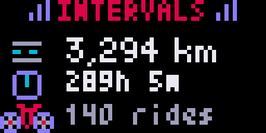
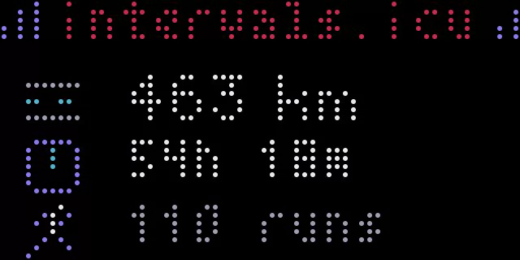
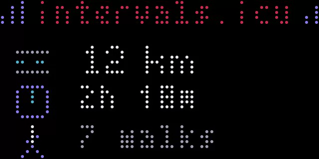
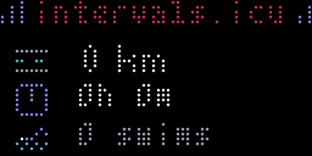
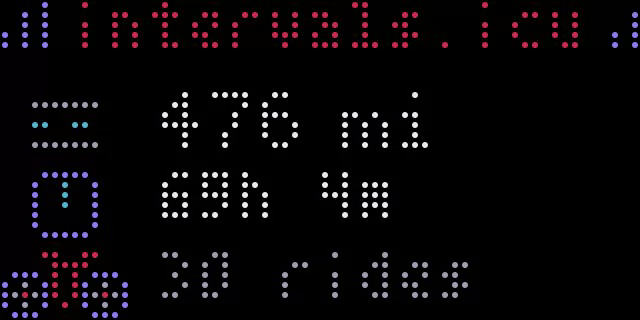

# Intervals Stats for Tronbyt

A [Tronbyt](https://tronbyt.com) / [Pixlet](https://tronbyt.com/pixlet/getting-started/) app for a 64x32 display. It shows your [Intervals.icu](https://intervals.icu) totals for one activity group: distance, moving time and number of activities.



## Features

- Year-to-date (YTD) or all-time (Total) stats
- Distance in kilometres or miles
- Moving time and activity count
- Animated icons for each stat, with a bicycle, runner, walker or swimmer depending on the activity
- Title that alternates between **intervals.icu** and the activity and period, e.g. `CYCLING YTD`
- Colours taken from the Intervals.icu dark theme

## Screenshots

These animations are recordings of Pixlet's browser simulator, including its
LED-dot effect. They show live data and the current `intervals.icu` heading.

| Cycling (total) | Running (total) |
|---|---|
|  |  |

| Walking (total) | Swimming (total) |
|---|---|
|  |  |

| Cycling (year to date, miles) |
|---|
|  |

## Settings

| Setting | Options | Default |
|---|---|---|
| API key | Your Intervals.icu API key | none (required) |
| Athlete ID | Your athlete ID, e.g. `i12345`, or `0` for the owner of the key | `0` |
| Activity | Cycling, Running, Walking / Hiking, Swimming | Cycling |
| Period | Year to date, All time | Year to date |
| Units | Kilometres, Miles | Kilometres |

### Activity groups

Intervals.icu has many activity types, so they are grouped:

| Group | Intervals.icu activity types |
|---|---|
| Cycling | Ride, VirtualRide, GravelRide, MountainBikeRide, EBikeRide, EMountainBikeRide, Cyclocross, TrackRide, Velomobile, Handcycle |
| Running | Run, VirtualRun, TrailRun |
| Walking / Hiking | Walk, Hike |
| Swimming | Swim, OpenWaterSwim |

Other activity types, and non-activity records such as wellness, fitness and fatigue, are ignored.

## Getting your API key

1. Sign in to [Intervals.icu](https://intervals.icu).
2. Open **Settings** and scroll to **Developer Settings**.
3. Create or copy your **API key**.

The key is entered in the app settings on your Tronbyt server, where the field is marked as a secret. Treat the key like a password. Anyone who has it can read your Intervals.icu data, so don't share it or commit it to a repository. You can regenerate it at any time in the same place.

## Running locally

Install [Pixlet](https://tronbyt.com/pixlet/installing/), then from the repository root:

```sh
pixlet serve apps/intervalsstats/intervalsstats.star
```

Open <http://localhost:8080> and enter your API key in the settings form.

To render to a file instead:

```sh
export INTERVALS_API_KEY=your-key-here
pixlet render apps/intervalsstats/intervalsstats.star api_key=$INTERVALS_API_KEY period=total group=cycling units=km --format gif --magnify 8 -o preview.gif
```

If your network blocks access to intervals.icu, set a proxy before running Pixlet or the Tronbyt server, for example `export HTTPS_PROXY=http://proxy.example:3128`. Pixlet's HTTP timeout defaults to 5 seconds, so `export PIXLET_HTTP_TIMEOUT=30s` helps on slow connections.

To validate the app:

```sh
pixlet lint apps/intervalsstats/intervalsstats.star
pixlet check apps/intervalsstats/intervalsstats.star
```

## Installing on a Tronbyt server

Either upload `apps/intervalsstats/intervalsstats.star` as a custom app in the Tronbyt server web UI, or add this repository under **Settings → Content and Firmware → Custom Apps Repository** if your server allows it. Then add **Intervals Stats** to your device and fill in the settings.

## How it works

- The app makes one request to `GET https://intervals.icu/api/v1/athlete/{id}/activities`, asking only for the `type`, `distance` and `moving_time` fields.
- It authenticates with HTTP Basic auth, using the username `API_KEY` and your key as the password.
- The year-to-date period starts on 1 January of the current year. The all-time period starts in 2000.
- Intervals.icu has no totals endpoint, so the app adds up the matching activities itself. The response is cached for one hour.
- Distances arrive in metres and times in seconds, and are converted for display.
- Activities with no distance or time count towards the activity total but add 0 to the other two.

## Error messages

| Message on the display | Meaning |
|---|---|
| Set your Intervals.icu API key | No key entered |
| Invalid API key | Intervals.icu rejected the key |
| API error N | Intervals.icu returned HTTP status N |

## Files

| Path | Purpose |
|---|---|
| `apps/intervalsstats/intervalsstats.star` | The app |
| `apps/intervalsstats/manifest.yaml` | App metadata for the Tronbyt community apps repository |
| `apps/intervalsstats/intervalsstats.webp`, `intervalsstats@2x.webp` | Preview images for the community apps repository |
| `images/` | Screenshots used in this README |

The `apps/<app name>/` layout is the one Tronbyt servers expect in a custom apps repository.

## Author

Jaime Fordham ([github.com/jaimefordham](https://github.com/jaimefordham))

This project is not affiliated with Intervals.icu. The colour palette is taken from the Intervals.icu website.
